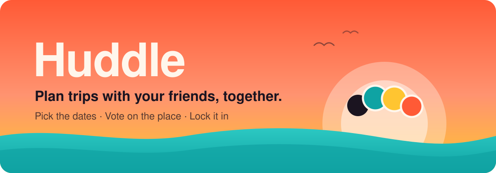
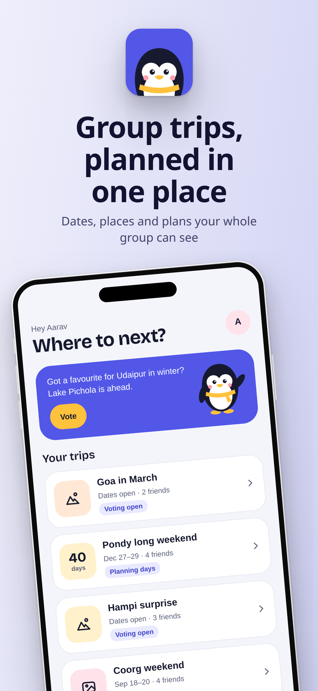
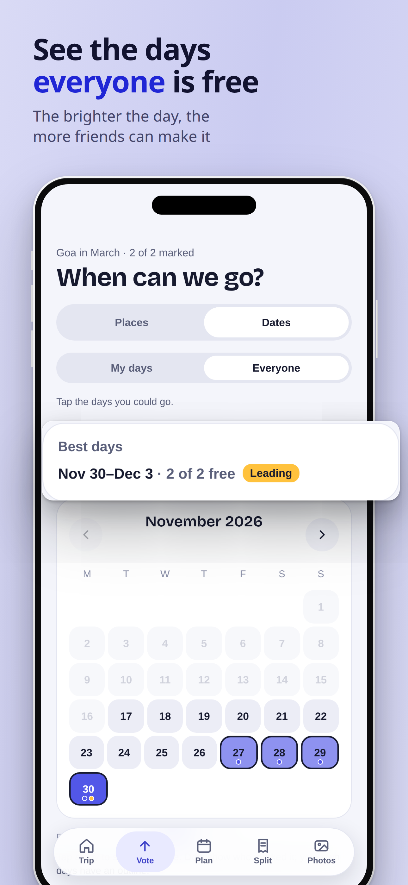
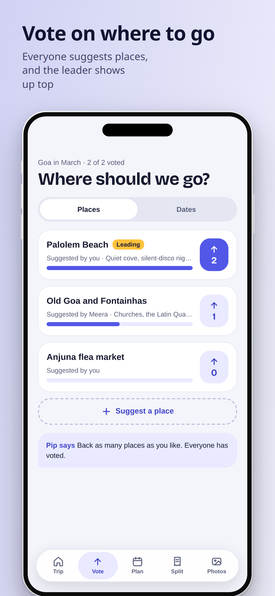
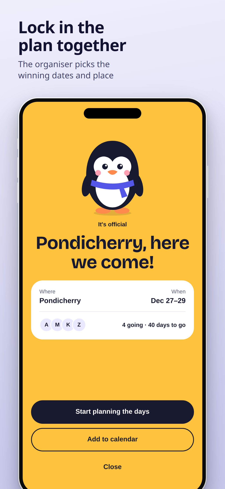
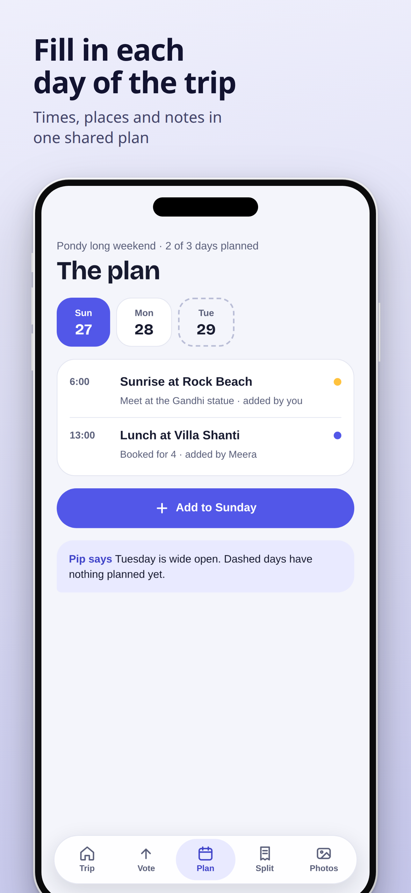
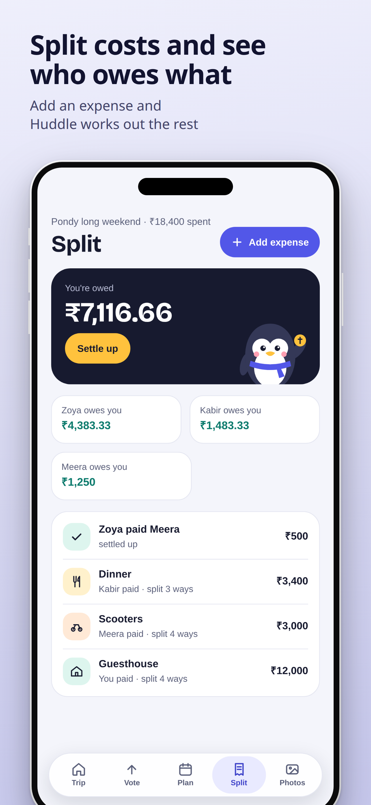

  

  
  

  
  

  
  
  

  
  
  

---

## Say goodbye to the group-chat chaos

Someone says *"we should all go on a trip!"* and everyone loves the idea. Then come 300 messages. Who's free when? Where should we go? Did anyone see the link I sent? Wait, which weekend did we pick?

**Huddle fixes that.** It's one place where your group:

> **finds the dates** everyone can make,
> **votes on where to go**,
> **plans each day** of the trip, and
> **splits the costs** without awkward maths.

No spreadsheets, no endless polls, no scrolling back through the chat.

---

## How it works

<table>
  <tr>
    <td align="center" width="25%">
      <h1>1</h1>
      <h3>Start a trip</h3>
      Give it a name like <i>"Goa with the gang"</i> and pick a colour.
    </td>
    <td align="center" width="25%">
      <h1>2</h1>
      <h3>Invite friends</h3>
      Share a short invite code or link on WhatsApp, Instagram, anywhere.
    </td>
    <td align="center" width="25%">
      <h1>3</h1>
      <h3>Decide together</h3>
      Everyone taps the days they're free and suggests places. Then you all vote.
    </td>
    <td align="center" width="25%">
      <h1>4</h1>
      <h3>Lock it in</h3>
      The organiser picks the winning dates and place. Trip on!
    </td>
  </tr>
</table>

---

## What you can do

### Find dates that work for everyone

Tap the days you're free on a simple calendar. Switch to **Everyone** to see the whole group at once: the brighter the day, the more friends can make it. Huddle points out the **best days** for you, so nobody has to count.

### Suggest places and vote

Add a place you'd love to go, with a short note, a link (an Instagram reel, a blog post, a hotel page) and a photo. Everyone votes for as many places as they like, and the **leader** sits at the top.

### Lock in the plan

When the group has decided, the organiser locks in the dates and the place. Everyone gets a trip summary to share, and you can add the trip to your calendar in one tap.

### Plan each day

Add what's happening on each day of the trip: sunrise at the beach at 6, lunch at 1. Everyone sees the same plan, and Huddle shows which days are still empty.

### Split the costs

Add what you spent and who it was for. Huddle works out who owes whom, and you can mark it settled once someone pays you back.

### Share your photos

Put everyone's trip photos in one shared album, sorted by day.

### See changes as they happen

When a friend marks their days, votes or adds a plan, you see it straight away. No refreshing, no *"did you see my message?"*.

### Stay in control

- Organisers can **rename**, **re-plan** or **delete** a trip.
- Plans changed? Anyone can **leave a trip** in one tap.
- You can delete your account whenever you like.

### Looks good day and night

Huddle has a bright, friendly look with Pip the penguin as your guide, and switches to **dark mode** when your phone does. Prefer one look all the time? Pick **Light** or **Dark** on the **You** tab.

---

## Get Huddle on your Android phone

Huddle isn't on the Play Store yet, so you install it straight from this page. It takes about a minute.

1. **On your Android phone**, open the [latest Huddle release](https://github.com/pratikstemkar/huddle/releases/latest).
2. Scroll down to **Assets** and tap the file whose name ends in **`.apk`** (for example `huddle-1.1.0-….apk`). It will download.
3. Open the downloaded file, from your notifications or your **Downloads** folder.
4. If your phone says it can't install apps from this source, tap **Settings**, turn on **Allow from this source**, then go back. Phones ask this for any app that doesn't come from the Play Store.
5. Tap **Install**, then **Open**.
6. Sign in with Google and start your first trip.

**Updates:** Huddle picks up most updates by itself the next time you open it. Now and then a bigger update comes out on the same releases page. Install it the same way and it replaces the old version. Your trips are kept.

**iPhone:** coming soon.

---

## Questions

**Does it cost anything?**
No. Huddle is free and has no ads.

**Do my friends need the app too?**
Yes. Send them your trip's invite link or code and they can join once they have Huddle.

**Who can see my trip?**
Only the people in it. Anyone with your invite link can join, so share it with your group only.
