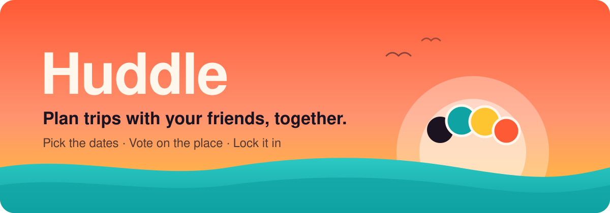

  

  
  
  

  
  
  

---

## 👋 Say goodbye to the group-chat chaos

You know how it goes. Someone says *"we should all go on a trip!"* and everyone loves the idea. Then come 300 messages: who's free when, where should we go, did anyone see the link I sent, wait, which weekend did we pick again?

**Huddle fixes that.** It's one simple place where your group:

> 🗓️ **picks the dates** everyone can make,
> 🗳️ **votes on where to go**, and
> 🔒 **locks in the plan** so nobody's left wondering.

No spreadsheets. No endless polls. No scrolling back through the chat.

---

## ✨ How it works

<table>
  <tr>
    <td align="center" width="25%">
      <h1>1️⃣</h1>
      <h3>🎒 Start a trip</h3>
      Give it a name like <i>"Goa with the gang"</i> and pick a colour you like.
    </td>
    <td align="center" width="25%">
      <h1>2️⃣</h1>
      <h3>💌 Invite friends</h3>
      Share a short invite code or link on WhatsApp, Instagram, anywhere.
    </td>
    <td align="center" width="25%">
      <h1>3️⃣</h1>
      <h3>🗓️ Plan together</h3>
      Everyone taps the days they're free and suggests places to go. Then you all vote.
    </td>
    <td align="center" width="25%">
      <h1>4️⃣</h1>
      <h3>🎉 Lock it in</h3>
      The organiser picks the winning dates and place. Trip on! 🏖️
    </td>
  </tr>
</table>

---

## 🌈 Features

### 🗓️ Find dates that work for everyone

Tap the days you're free on a simple calendar. Switch to the **Everyone** view to see a colourful heat map: the brighter the day, the more friends are free. Huddle even shows the **best days** for the group, so you don't have to work it out yourself.

### 📍 Suggest places to go

Got a dream destination? Add it with a short note, a link (an Instagram reel, a blog post, a hotel page) and a picture so everyone can see why it's a great idea.

### 🗳️ Vote on your favourites

Everyone votes for the places they like. The **top 3** show up right on the trip page, so you always know what's winning.

### ⚡ See changes as they happen

When a friend marks their days or casts a vote, you see it **instantly**. No refreshing, no "did you see my message?".

### 🔒 Lock in the final plan

Once the group has spoken, the trip organiser locks in the dates and the destination. Huddle shows a neat **trip summary** you can share with everyone, and the dates appear on your trips list.

### 👥 Know who's coming

See everyone who has joined the trip at a glance.

### 🛠️ Stay in control

- ✏️ Organisers can **rename** or **delete** a trip.
- 👋 Plans changed? Anyone can **leave a trip** in one tap.

### 🌙 Looks great day and night

Huddle has a warm, sunset-inspired look and switches to **dark mode** automatically when your phone does.

---

## 📲 Get the app

Huddle is almost ready! 🚧 We're putting the finishing touches on it before it goes live.

| | Where | Status |
|:-:|---|---|
| 🍎 | **iPhone** on the App Store | ⏳ Coming soon |
| 🤖 | **Android** on Google Play | ⏳ Coming soon |
| 🌐 | **Any browser**, no download needed | ⏳ Coming soon |

> ⭐ **Want to know the moment it's out?** Click the **Star** button at the top of this page, or click **Watch** to get notified about new releases.

---

## 🙋 Questions people ask

<b>💸 Is Huddle free?</b>

 
Yes, completely free, with no ads. Huddle is open source, which means anyone can see how it's made.

<b>📱 Do all my friends need the same kind of phone?</b>

 
Nope! Huddle works on iPhone, Android and in a web browser, and everyone plans together on the same trip, whatever they use.

<b>🔑 How do I sign in?</b>

 
With your Google account, or with your Apple ID on iPhone. No new password to remember.

<b>🔐 Who can see my trip?</b>

 
Only the people in that trip. Someone can only join if you share the trip's invite code or link with them.

<b>👑 Who is the "organiser"?</b>

 
The person who creates the trip. They're the one who locks in the final dates and destination once the group has voted, and they can rename or delete the trip.

<b>🧳 Does Huddle book flights or hotels?</b>

 
Not yet. Huddle is all about the hardest part: getting everyone to agree on <i>when</i> and <i>where</i>. Once that's sorted, you book things however you like.

---

## 💬 Say hello

Found a bug 🐞, have an idea 💡, or just want to say you love it ❤️?
[Open an issue](https://github.com/pratikstemkar/huddle/issues/new) and tell us about it. You don't need to be technical; just describe it in your own words.

   
  Made with ☀️ for everyone who's ever been stuck in a group chat trying to plan a trip.
    
  Are you a developer who wants to help build Huddle? Have a look at <a href="CONTRIBUTING.md">CONTRIBUTING.md</a>.

